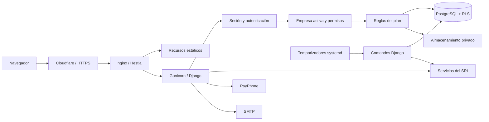

<div align="center">
  
  <h1>FacturaPorAquí</h1>
  <p><strong>Tu negocio, en orden.</strong></p>
  <p>Facturación electrónica y gestión empresarial para Ecuador.</p>
  <p>
    <a href="https://facturaporaqui.com">Conocer los planes</a> ·
    <a href="https://app.facturaporaqui.com">Ingresar a la aplicación</a> ·
    <a href="entregas/facturaporaqui/HANDOFF.md">Estado del proyecto</a>
  </p>
</div>

## Guía de lectura

- **Clientes:** [manual de uso en PDF](entregas/facturaporaqui/manuales/Manual-de-uso-FacturaPorAqui.pdf).
- **Producto:** [funciones](#funciones-disponibles) y [planes](#planes-anuales).
- **Desarrollo:** [entorno de pruebas](#preparar-un-entorno-de-pruebas), [arquitectura y operación](#referencia-técnica-para-desarrollo-y-operación).
- **Coordinación:** [HANDOFF](entregas/facturaporaqui/HANDOFF.md) y [resultados frontend](entregas/facturaporaqui/RESULTADOS-FRONTEND.md).

## Qué es FacturaPorAquí

Una plataforma web para gestionar comprobantes electrónicos, clientes, productos, compras, ventas, cobros y pagos. Permite trabajar con varias empresas mediante un selector, roles por empresa y aislamiento de datos.

Este repositorio contiene la aplicación Django, la landing comercial, pruebas, recursos de marca y documentación de desarrollo. **El contenido de una rama puede incluir propuestas aún no publicadas**: consulta [HANDOFF.md](entregas/facturaporaqui/HANDOFF.md) para conocer lo que está en producción.

## Funciones disponibles

| Área | Alcance |
| --- | --- |
| Comprobantes electrónicos | Facturas, notas de crédito, notas de débito, retenciones, liquidaciones de compra y guías de remisión. |
| Configuración de facturación | Asistente para configurar establecimientos, puntos de emisión y numeración. |
| Gestión comercial | Clientes, proveedores, productos, compras, ventas, inventario, cuentas por cobrar y por pagar. |
| Multiempresa | Empresas separadas, membresías, roles y selector de empresa activa. |
| Importación | Recepción y revisión de XML/RIDE; incluida en Ilimitado y Multiempresa. |
| Suscripciones | Planes anuales y pagos mediante PayPhone. |
| Documentos imprimibles | RIDE A4 y ticket térmico; consulta el estado de cada actualización visual en HANDOFF. |

## Planes anuales

Precios en dólares de Estados Unidos, **IVA incluido**.

| Plan | Precio anual | Empresas | Comprobantes | Importación XML/RIDE |
| --- | ---: | --- | --- | --- |
| Plan 1000 | $50 | 1 RUC | Hasta 1000 por año | No incluida |
| Ilimitado | $85 | 1 RUC | Ilimitados | Incluida |
| Multiempresa | $199 | Hasta 10 RUC distintos | Ilimitados | Incluida |

La mejora de Plan 1000 a Ilimitado cuesta **$35** y conserva el vencimiento del período actual: no inicia una nueva anualidad.

### Próximamente

- **Proformas**, incluidas en todos los planes pagados: cotizaciones en PDF y por correo, sin envío al SRI ni consumo del cupo; conversión a factura para revisión.
- **Complemento Contable**, con contratación aparte y **precio por anunciar**: bancos y caja, importación de extractos, conciliación, plan de cuentas, asientos, kardex, libros, balances y estados financieros.
- **Herramientas tributarias** del complemento: preparación de hojas del 104 y del 103, generación de XML del ATS y las etapas de apoyo al 101, ADI y pago a cuenta previstas en el plan.

El contribuyente revisa y presenta su información en **SRI en Línea**. Estas herramientas no se presentan como declaraciones automáticas ni como software homologado o certificado por el SRI.

Consulta el [plan de Proformas, Bancos y Contabilidad](entregas/facturaporaqui/PLAN-PROFORMAS-BANCOS-CONTABILIDAD.md) y las [maquetas de la fase contable](entregas/facturaporaqui/propuestas/fase-contable/README.md). Son propuestas hasta que se confirme su implementación y publicación.

## Tecnología

- **Backend:** Python 3.12 y Django 5.2.
- **Base de datos:** PostgreSQL en el entorno multiempresa; SQLite para pruebas locales compatibles.
- **Interfaz:** plantillas Django, AdminLTE 3.2, Bootstrap 4.6, JavaScript y Chart.js.
- **Documentos:** XML y PDF, con WeasyPrint para impresión.
- **Infraestructura:** scripts de despliegue, servicios y temporizadores systemd; aplicación y landing en dominios separados.

Las bibliotecas de la app se sirven desde `static/lib`. Su inventario se encuentra en [MANIFIESTO.json](static/lib/MANIFIESTO.json); consulta también [DEPENDENCIAS-FRONTEND.md](entregas/facturaporaqui/DEPENDENCIAS-FRONTEND.md).

## Organización del repositorio

```text
core/                         Aplicaciones Django y lógica del negocio
config/                       Configuración y rutas del proyecto
templates/                    Plantillas compartidas y estilos/pie del RIDE
static/                       Tema, JavaScript, marca y bibliotecas locales
landing/                      Sitio comercial independiente
requirements/                 Dependencias fijadas con hashes
tests/                        Pruebas automatizadas
deploy/                       Herramientas de operación y despliegue
entregas/facturaporaqui/       Coordinación, informes, capturas y propuestas
```

### Ramas y coordinación

- **`plataforma`**: desarrollo del backend e integración a cargo de Claude.
- **`frontend/etapa3`**: diseño de la aplicación, marca y propuesta comercial a cargo de Codex.
- **`main`**: conserva la base histórica; no asumir que contiene la última versión operativa.

Antes de trabajar, leer [AGENTS.md](entregas/facturaporaqui/AGENTS.md) y [HANDOFF.md](entregas/facturaporaqui/HANDOFF.md). Integrar los cambios compartidos sin reescribir el historial y registrar cada entrega. Las propuestas de `entregas/` no son módulos desplegados.

## Preparar un entorno de pruebas

Se necesita acceso al repositorio privado, Python 3.12 y las bibliotecas de sistema requeridas por [WeasyPrint](https://doc.courtbouillon.org/weasyprint/stable/first_steps.html). Para validar PostgreSQL se requiere además una base dedicada a pruebas.

```bash
git clone --branch frontend/etapa3 https://github.com/Jen456/invoice15.git
cd invoice15
python3.12 -m venv .venv
```

Activar el entorno en Linux/macOS:

```bash
source .venv/bin/activate
```

En PowerShell, después de crear el entorno con Python 3.12:

```powershell
.\.venv\Scripts\Activate.ps1
```

Instalar las dependencias de aplicación y pruebas:

```bash
python -m pip install --require-hashes -r requirements/base.txt -r requirements/dev.txt
```

Ejecutar la suite local:

```bash
python -m pytest
```

`pytest.ini` selecciona `config.settings_test`: utiliza SQLite en memoria y correo en memoria. Las pruebas específicas de concurrencia y aislamiento por filas requieren PostgreSQL mediante `FPA_TEST_DATABASE_URL`, apuntando exclusivamente a una base de pruebas. Un resultado en SQLite no sustituye esas verificaciones.

Para una revisión acotada de recursos y rutas:

```bash
python -m pytest tests/test_estaticos.py tests/test_rutas.py
```

Estos pasos preparan **pruebas**, no un servidor de producción. La puesta en marcha de una instancia requiere su configuración de entorno, base de datos y almacenamiento privado. No crear migraciones como paso de instalación ni utilizar usuarios o contraseñas predeterminados.

### Ver la landing y las maquetas

Desde la raíz del repositorio:

```bash
python -m http.server 8031 --bind 127.0.0.1
```

- Landing: <http://localhost:8031/landing/>
- Maquetas contables: <http://localhost:8031/entregas/facturaporaqui/propuestas/fase-contable/>

Las maquetas usan datos ficticios. El formulario de contacto de la landing sigue siendo demostrativo mientras no se configure e integre un destino real; no implica captación persistente de solicitudes.

## Documentación y marca

- [Estado, contratos y pendientes entre agentes](entregas/facturaporaqui/HANDOFF.md).
- [Resultados y verificaciones del frontend](entregas/facturaporaqui/RESULTADOS-FRONTEND.md).
- [Importación de comprobantes](entregas/facturaporaqui/IMPORTACION-COMPROBANTES.md).
- [Plan de la fase contable](entregas/facturaporaqui/PLAN-PROFORMAS-BANCOS-CONTABILIDAD.md).
- [Investigación normativa y puntos por confirmar](entregas/facturaporaqui/NORMA-CONTABLE-TRIBUTARIA-2026-10.md).
- [Propuesta RIDE A4](entregas/facturaporaqui/propuestas/ride-b/README.md) y [ticket térmico](entregas/facturaporaqui/propuestas/ticket-b/README.md).
- [Material comercial de la fase contable](entregas/facturaporaqui/redes/fase-contable/README.md).

La identidad utiliza el **colibrí Ingenioso**, coral `#CA462C`, celeste `#44BADD`, azul claro `#E5F1F6` y azul oscuro `#163B50`. Se priorizan lectura, contraste, foco visible, adaptación móvil y movimiento reducido.

## Publicación y contribuciones

Los procedimientos se mantienen en [desplegar.sh](deploy/scripts/desplegar.sh) y [publicar-landing.sh](deploy/scripts/publicar-landing.sh). La publicación requiere revisión, autorización de la propietaria, respaldo y verificación posterior. Un push a GitHub no equivale a un despliegue.

Trabajar con empresas y documentos ficticios. No incluir credenciales, claves privadas, firmas electrónicas ni datos de clientes en commits, documentación o capturas. Los cambios fiscales y de datos deben coordinarse con el responsable del backend.

Este proyecto evolucionó a partir de Sistema Invoice de AlgoriSoft. Se reconoce ese origen; la marca y las adaptaciones actuales corresponden a FacturaPorAquí. La disponibilidad del repositorio no concede por sí sola una licencia de redistribución: revisar los términos aplicables al proyecto original y a sus dependencias.

## Referencia técnica para desarrollo y operación

Esta sección describe el código de la rama, revisado el **28 de octubre de 2026**. Las rutas y variables se documentan sin valores secretos. La versión desplegada y los contratos de cada entrega se registran en HANDOFF; los documentos de diseño antiguos pueden describir estados anteriores.

### Arquitectura y recorrido de una petición



La landing se sirve de forma independiente. La aplicación usa HTML renderizado en el servidor y JavaScript para formularios, tablas y peticiones JSON; no es una SPA ni una API pública general. La autenticación normal es por sesión y las escrituras conservan CSRF.

| Módulo | Responsabilidad | Entrada principal |
| --- | --- | --- |
| `core.login` | Ingreso por usuario/correo/identificación, registro y recuperación | `/login/`, `/registro/` |
| `core.tenancy` | Membresías, contexto, aislamiento y administración de plataforma | `/empresas/`, `/plataforma/` |
| `core.security` / `core.user` | Menús, permisos, perfiles y archivos protegidos | `/security/`, `/user/`, `/media/` |
| `core.pos` | Empresa, clientes, productos, compras, ventas y notas de crédito | `/pos/` |
| `core.configuracion` | Asistente de facturación y numeraciones | `/configuracion/facturacion/` |
| `core.comprobantes` | Retenciones, liquidaciones, notas de débito y guías | `/comprobantes/` |
| `core.importacion` | Lotes XML/PDF, verificación y revisión | `/importacion/` |
| `core.suscripciones` | Planes, períodos, cobertura y pagos | `/suscripcion/` |
| `core.dashboard` / `core.reports` | Panel y reportes | `/dashboard/`, `/reports/` |

Referencia de rutas: [config/urls.py](config/urls.py). Proformas, Bancos, Contabilidad y Tributario siguen planificados; las maquetas no añaden estas aplicaciones al backend.

### Multiempresa, roles y límites de acceso

1. `CompanyMiddleware` resuelve la empresa desde la sesión y comprueba la membresía activa. El cliente no decide libremente el `company_id` de una operación.
2. El contexto de `core.tenancy.context` usa `contextvars`. Los gestores de empresa exigen un contexto válido; una consulta sin empresa falla cerrada.
3. Las relaciones entre registros deben permanecer dentro de la misma empresa.
4. PostgreSQL añade políticas RLS mediante `app.company_id` y `app.platform`. SQLite no reproduce esta capa. El rol PostgreSQL de la aplicación no debe eludir RLS con privilegios de superusuario/BYPASSRLS.
5. Los procesos de fondo usan `company_context(company)`; `platform_scope()` es un acceso explícito de plataforma, no un atajo para código ordinario de empresa.

Seis roles: Propietario, Administrador, Contador, Vendedor, Consulta y Cliente. La matriz efectiva reside en [core/tenancy/roles.py](core/tenancy/roles.py) y en los permisos de cada vista. Actualmente el rol Contador tiene lectura en sus módulos; la escritura contable pertenece al plan de la siguiente fase. Un Administrador de empresa no equivale al superusuario de `/plataforma/`.

### Configuración por entorno

[config/settings.py](config/settings.py) lee variables del proceso; admite un archivo indicado mediante `FPA_ENV_FILE` o el archivo local previsto por el proyecto. Los secretos se provisionan fuera de Git. Esta tabla describe nombres y finalidad, no es una configuración lista para producción.

| Variables | Finalidad |
| --- | --- |
| `FPA_ENTORNO`, `FPA_ENV_FILE` | Etiqueta del entorno y ubicación opcional de su configuración. |
| `SECRET_KEY`, `DEBUG` | Clave propia de Django y modo de depuración; depuración desactivada en servicio. |
| `ALLOWED_HOSTS`, `CSRF_TRUSTED_ORIGINS`, `FPA_URL_APP` | Dominios admitidos, orígenes confiables y URL pública para retornos. |
| `DATABASE_URL`, `DB_CONN_MAX_AGE` | Conexión de base de datos y reutilización; PostgreSQL en servicio. |
| `FPA_CLAVES_CIFRADO` | Lista de llaves Fernet. La primera cifra; las restantes permiten descifrar durante rotaciones. |
| `FPA_ARCHIVOS` | Raíz privada de archivos subidos (`MEDIA_ROOT`). |
| `STATIC_ROOT`, `FPA_STATIC_STORAGE` | Salida y almacenamiento de recursos estáticos; en servicio se usan nombres con huella. |
| `FPA_X_ACCEL_PREFIX` | Delegación opcional a una ubicación nginx `internal`; vacío entrega desde Django. |
| `EMAIL_BACKEND`, `EMAIL_HOST`, `EMAIL_PORT` | Transporte del correo de plataforma. En desarrollo se puede usar consola; pytest usa memoria. |
| `EMAIL_HOST_USER`, `EMAIL_HOST_PASSWORD`, `EMAIL_USE_TLS`, `EMAIL_TIMEOUT`, `DEFAULT_FROM_EMAIL` | Autenticación, TLS, espera y remitente de plataforma. El correo de cada empresa tiene configuración propia. |
| `PAYPHONE_TOKEN`, `PAYPHONE_STORE_ID`, `PAYPHONE_API_BASE`, `PAYPHONE_TIMEOUT` | Integración de cobros. Sin token se deshabilita el botón; no configurar producción en pruebas ordinarias. |
| `FPA_CORREO_FACTURACION` | Destino administrativo de avisos de pagos y solicitudes de factura de suscripción. |
| `FPA_RUC_PROVEEDOR`, `FPA_PROVEEDOR_NOMBRE`, `FPA_PROVEEDOR_EMAIL`, `FPA_PROVEEDOR_DIRECCION` | Identificación del proveedor en XML/impresos. Un RUC de proveedor inválido o ausente bloquea emisión en Producción. |
| `FPA_REGISTRO_HORAS_ENLACE`, `FPA_REGISTRO_MAX_POR_HORA` | Vigencia y límite del registro; valores por defecto en código: 72 horas y 5 por hora. |
| `FPA_LOGIN_MAX_INTENTOS`, `FPA_LOGIN_BLOQUEO_SEGUNDOS` | Control de intentos fallidos; por defecto 5 y 900 segundos. |
| `SESSION_COOKIE_SECURE`, `CSRF_COOKIE_SECURE`, `SESSION_COOKIE_AGE`, `SECURE_HSTS_SECONDS` | Seguridad y duración de cookies/HSTS; sesión por defecto de 8 horas. |
| `FPA_LOGS`, `LOG_LEVEL` | Directorio opcional de registros y nivel de log. |
| `FPA_PUERTO`, `FPA_WORKERS` | Variables usadas por el servicio Gunicorn, no por el negocio. |
| `FPA_TEST_DATABASE_URL` | Base PostgreSQL exclusiva para ejecutar pruebas. |

Idioma `es-ec`, zona `America/Guayaquil`, `USE_TZ=True`. El caché es compartido en base de datos (`fpa_cache`), no memoria aislada de cada worker. Crear su tabla forma parte de la instalación.

### Preparación de una instancia de desarrollo

Después de instalar dependencias, provisionar una configuración local aislada: clave propia, base vacía, depuración local, hosts locales, almacenamiento local y correo a consola. No usar datos ni conexiones de producción. Ejecutar sobre esa instancia:

```bash
python manage.py check
python manage.py migrate
python manage.py createcachetable
```

La instalación inicial utiliza `start_installation --admin-correo <correo> --archivo-credenciales <ruta-privada-nueva>`. Los argumentos son marcadores: el operador aporta sus valores de forma privada. El comando crea módulos/perfiles y genera una contraseña aleatoria en un archivo nuevo de permisos 0600; rechaza una instalación ya inicializada. No registra esa contraseña en el README ni hay contraseña universal.

```bash
python manage.py runserver 127.0.0.1:8000
```

Registrar una empresa ficticia desde `/registro/` permite recorrer el asistente desde cero. `insert_test_data` se reserva a bases de demostración tras revisar su alcance; no es requisito de producción. `settings_test` es exclusivamente para pytest, no para servir una aplicación persistente. No usar `makemigrations` para instalar: se aplican las migraciones versionadas.

### Archivos privados, cifrado y PDF

- Los archivos de empresa tienen rutas con UUID y nombres aleatorios. Se verifican sesión, empresa y permisos al entregarlos.
- `/media/` bloquea firmas `.p12`/`.pfx`, claves, respaldos y `privado/`. Los importados se descargan desde una vista con permiso propio. No servir `MEDIA_ROOT` como directorio público en nginx.
- Permisos de subida: archivos 0640 y directorios 0750. Evitar setgid/setuid en directorios creados por el servicio: su aislamiento activa `RestrictSUIDSGID`.
- La **contraseña de la firma** usa `ClaveCifrada`/Fernet en la base. En esta revisión `email_host_password` sigue siendo un campo de texto: no afirmar que todo secreto de la base está cifrado. Los formularios no deben devolver las claves guardadas al navegador.
- La rotación de llaves requiere mantener las anteriores, respaldarlas por un canal seguro, recifrar y verificar antes de retirarlas. Perder todas las llaves impide recuperar los valores cifrados; un volcado de base por sí solo no basta.
- RIDE A4: estilos compartidos en `templates/ride/_estilos.html` y pie `_pie.html`. Ticket: 58 mm, área útil aproximada de 48 mm y alto calculado por `printer.create_pdf_continuo` mediante `alto_pagina`.
- Un PDF autorizado se conserva como archivo. Cambiar una plantilla no redibuja automáticamente los PDF históricos; su regeneración es una operación separada, respaldada y fiel al XML.

### Emisión electrónica y numeración

La firma vigente es **XAdES-BES en Python**, en `core/pos/utilities/firma.py`; no se debe seguir la instrucción histórica de instalar Java para esta implementación. Valida el certificado y su clave RSA. Los servicios SRI se seleccionan según ambiente: **1 Pruebas / 2 Producción**; el nombre del entorno de despliegue no determina por sí solo el ambiente fiscal de una empresa.

La secuencia se separa por empresa, ambiente, establecimiento, punto de emisión y tipo de documento. La configuración recibe el último número utilizado y presenta el próximo. No reiniciar ni retroceder secuencias para arreglar una apariencia del formulario.

El flujo construye y firma XML, lo presenta al SRI y consulta autorización. Hay estados intermedios, autorizados y de error. Un timeout no demuestra rechazo: un documento en proceso puede estar recibido por el SRI. Se conserva su clave y número para consultar, sin crear duplicados ni renumerar. El código tiene llamadas acotadas y consultas posteriores; no es una cola Celery ni toda la emisión está desacoplada de la petición HTTP.

Una autorización y la entrega por correo son resultados distintos. Los reintentos, reglas de borrado y estados vigentes están en [core/pos/emision.py](core/pos/emision.py). Las decisiones fiscales se implementan y prueban en backend, no con JavaScript de presentación.

### Suscripciones y PayPhone

Los permisos del rol y las reglas comerciales se validan en servidor. `PlanMiddleware` y `core/suscripciones/reglas.py` controlan rutas pagadas, importación reservada a planes ilimitados y límites. El plan gratuito ofrece funciones de inventario limitadas: los límites efectivos provienen de configuración; el respaldo del código es 50 productos, 10 proveedores y 30 compras al mes.

El navegador inicia/retorna del pago, pero la activación depende de la confirmación con PayPhone en el servidor y de sus verificaciones. No confiar en un parámetro de retorno como prueba de pago. Las operaciones guardan referencia, importe y eventos para evitar aplicaciones repetidas. La mejora de plan conserva su vencimiento según la cotización del backend. La cobertura del Multiempresa se administra desde `/suscripcion/empresas/` por la empresa titular.

Para pruebas usar dobles de PayPhone y las suites existentes. No completar cobros para verificar CSS. Las reglas del futuro complemento siguen pendientes de D9.

### Contrato de importación XML/RIDE

El parser actual declara `SOPORTADOS = ('01',)`: admite **facturas**, aunque el catálogo reconozca nombres de otros tipos. No confundir reconocimiento con importación implementada. La clasificación distingue emitido, recibido, ajeno y revisión manual comparando las identificaciones con la empresa activa.

| Límite actual | Valor |
| --- | ---: |
| XML individual | 2 MiB |
| PDF individual | 5 MiB |
| Páginas por PDF | 5 |
| Archivos por lote | 50 |
| Tamaño acumulado del lote | 60 MiB |
| Tamaño por petición | 9 MiB |

La interfaz divide las subidas en peticiones dentro del límite. Un archivo individual sigue sujeto a su máximo. Los límites completos están en [core/importacion/limites.py](core/importacion/limites.py).

Los XML se analizan sin resolver entidades ni acceder a red/DTD. Los PDF se procesan en un proceso aislado con tiempo, memoria y resolución limitados. El código busca una clave en texto/códigos del RIDE; no hace OCR para obtener impuestos ni abre una URL arbitraria del QR. Sin clave, la interfaz permite ingresarla manualmente. El XML y su contraste con SRI aportan los datos fiscales.

Los duplicados se controlan mediante huellas y claves por empresa/ambiente. La autorización declarada por un archivo no equivale a verificación con el SRI. Aprobar o vincular una importación **no crea automáticamente una compra ni un asiento contabilizado**; actualmente la propuesta contable no tiene libro mayor detrás.

Endpoints JSON internos, con sesión/empresa/permisos y CSRF para escritura:

- `/importacion/api/lotes/` y `/importacion/api/lotes/<id>/`.
- `/importacion/api/lotes/<id>/archivos/` y `/procesar/`.
- `/importacion/api/entradas/<id>/clave/`.
- `/importacion/api/documentos/`, `/<id>/`, `/<id>/verificar/` y `/<id>/revisar/`.
- `/importacion/api/reglas/`.

Consultar métodos y esquemas exactos en [core/importacion/views.py](core/importacion/views.py), [urls.py](core/importacion/urls.py) y el contrato de HANDOFF; no asumir una API externa estable.

### Procesos y observabilidad

Las siguientes son definiciones versionadas, no una afirmación de que estén activas en cualquier servidor:

| Unidad | Trabajo / frecuencia declarada |
| --- | --- |
| `facturaporaqui@<entorno>.service` | Gunicorn en loopback; timeout de 60 s, procesos configurables, reinicio del servicio. |
| `facturaporaqui-sri@<entorno>.timer` | Cada 5 minutos, con pequeño desfase; ejecuta `consultar_sri`. Puede consultar y reenviar XML pendientes. |
| `facturaporaqui-importacion@<entorno>.timer` | Cada 5 minutos, desplazado respecto al SRI; ejecuta `procesar_importaciones`. |
| `facturaporaqui-respaldo@<entorno>.timer` | Diario a las 18:15 de Ecuador, con hasta 120 s de desfase; persistente si se perdió una ejecución. |

No agregar otro cron equivalente sin revisar los temporizadores. Los servicios trabajan con usuario dedicado, permisos restringidos y directorios explícitos de escritura. Sus parámetros se mantienen en [deploy/systemd](deploy/systemd).

Comprobaciones de lectura que el operador puede adaptar al nombre real de su entorno:

```bash
systemctl status facturaporaqui@<entorno>.service
systemctl list-timers 'facturaporaqui-*'
journalctl -u facturaporaqui@<entorno>.service --since '30 minutes ago' --no-pager
```

`<entorno>` debe sustituirse antes de ejecutar. No publicar logs completos con datos privados. Revisar HTTP, estáticos, errores SRI/importación y la ejecución efectiva del respaldo; un HTTP 200 del login solo prueba disponibilidad básica.

### Operaciones de mantenimiento

Consultar `python manage.py <comando> --help` antes de usar un comando y confirmar entorno, alcance y respaldo.

| Comando | Alcance y precaución |
| --- | --- |
| `consultar_sri --limite ...` | Consulta pendientes y puede enviar XML firmados; produce efectos externos. |
| `procesar_importaciones --maximo ...` | Avanza lotes y recupera XML pendientes del SRI. |
| `claves_firma` / `--recifrar` | Gestión de claves cifradas y rotación; conservar llaves anteriores hasta verificar. |
| `regenerar_ride --empresa ... --numero ...` | Ensayo de regeneración de PDF; `--aplicar` requiere respaldo. No modifica el XML autorizado. |
| `limpiar_codigos_barra` | Informa; `--aplicar` habilita cambios. Revisar alcance y antigüedad. |
| `importar_facturero` | Importación administrativa; modo de ensayo por defecto, `--aplicar` persiste. |
| `limpiar_registros_pendientes` / `vencer_pagos_pendientes` | Mantenimiento del registro y de pagos; revisar argumentos y efectos en su implementación. |

Estos comandos no se ejecutaron al redactar este manual técnico.

### Despliegue, respaldo y reversión

El script versionado de la aplicación crea una release desde Git, instala dependencias con hashes, respalda PostgreSQL, aplica migraciones, crea caché, recopila estáticos, ejecuta comprobaciones y activa `current`. Reinicia el servicio y comprueba `/login/`. Conserva cinco releases y hasta treinta respaldos previos de despliegue. `entregas/` se excluye del archivo desplegado.

El respaldo diario conserva catorce volcados PostgreSQL, usa exclusión mutua y comprueba que el archivo contenga datos de suficientes tablas. Las políticas RLS exigen el alcance de plataforma previsto por los scripts para no generar un respaldo parcial. Además de la base deben preservarse archivos privados y llaves de cifrado mediante el procedimiento seguro de operación. La estrategia externa de copias debe verificarse en infraestructura; un script en Git no demuestra que una copia remota se haya realizado.

**Revertir código no revierte la base.** `desplegar.sh <entorno> --revertir` cambia a la release anterior; las migraciones/datos requieren evaluación y, si procede, restauración del respaldo correspondiente. La prueba de recuperación se hace en una instancia aislada, validando empresas, archivos, descifrado y versión antes de intervenir producción. Evitar instrucciones destructivas de restauración copiadas sin conocer la topología.

### Pruebas y criterios de integración

- SQLite: suite rápida funcional, datos ficticios y correo en memoria. PostgreSQL: concurrencia, bloqueo de numeración y RLS. No dar por validado aislamiento en PostgreSQL con un resultado de SQLite.
- Comprobar `python manage.py makemigrations --check --dry-run` en un entorno configurado cuando se evalúe compatibilidad de modelos; no crear migraciones desde tareas de diseño.
- Frontend: nombres, `action`, CSRF, contexto, permisos, estados de plan y mensajes del servidor conservados. Revisar móvil, teclado, movimiento reducido y errores/reintentos además del estado exitoso.
- PDF: comprobar páginas reales, texto, márgenes, descripciones largas y datos fiscales. Ticket: una hoja de 58 mm, 40 líneas largas sin cortes y menos de 12 mm de blanco final según su suite. Una inspección digital no sustituye una impresora o escáner físicos.
- Mantener dependencias fijadas y el manifiesto de bibliotecas. No introducir CDN ni Highcharts. Separar recursos de marca de logos de las empresas.
- Los contratos nuevos se coordinan en HANDOFF. La aprobación de una maqueta no autoriza cambiar reglas fiscales, datos históricos o publicar en producción.

### Diagnóstico rápido

| Síntoma | Revisar primero |
| --- | --- |
| Pantalla sin estilos | `static/lib`, manifiesto, `collectstatic`, respuesta de `/static/` y caché de navegador/proxy. |
| Error al guardar archivos | Propietario/permisos 0640/0750, directorios de escritura systemd y configuración de almacenamiento. No resolver con permisos universales. |
| Empresa incorrecta o sin acceso | Selector, membresía activa, rol, contexto y políticas RLS. |
| Firma no abre o aparece vacía | Certificado vigente, contraseña, archivo y llaves de descifrado del entorno. No registrar sus valores. |
| Documento en proceso | Clave/número existentes, respuesta SRI y temporizador; no emitir otro para sustituirlo. |
| PDF con aspecto anterior | Archivo guardado al autorizar, no solo versión de plantilla o caché. |
| PDF importado sin datos | Clave ausente, XML no recuperado, límites o discrepancia; revisar entrada del lote. |
| Pago sin plan activo | Referencia, confirmación del servidor, estado e importe; no activar basándose solo en la pantalla de retorno. |
| Error CSRF o sesión | Host/origen, HTTPS y proxy, cookies y envío del token; no deshabilitar CSRF para resolverlo. |

## Manual para clientes

[Descargar el manual de uso en PDF](entregas/facturaporaqui/manuales/Manual-de-uso-FacturaPorAqui.pdf) · [Fuente editable y regeneración](entregas/facturaporaqui/manuales/README.md).
