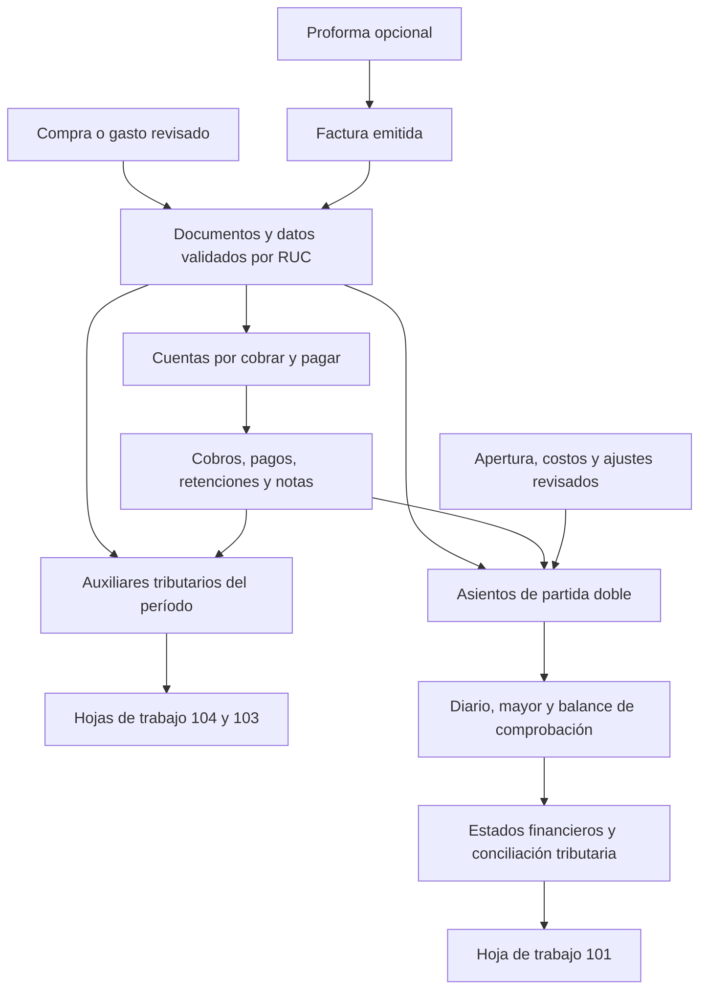

# ERPNext como referencia: alcance necesario para 104, 103 y 101

Fecha: 30/10/2026, Ecuador. Autor: Codex. **Análisis de código y propuesta de alcance; no implementación ni despliegue.** El chatbot con IA queda pendiente por decisión de la propietaria.

## Conclusión

FacturaPorAquí ya tiene gran parte de los documentos y movimientos comerciales que necesita. La brecha principal es transformar esos datos en auxiliares tributarios verificables y en un libro contable de partida doble. Añadir pantallas o restar compras de ventas no resuelve esa brecha.

De ERPNext conviene adaptar la separación entre documento, cobro/pago, inventario y asiento, y la trazabilidad entre ellos. No hace falta migrar a Frappe ni reproducir su CRM, fabricación, recursos humanos o todas sus órdenes comerciales. **Propuesta de prioridad: datos revisados → hojas 104/103 → núcleo contable y costos → cierre y hoja 101.** Es una recomendación para el objetivo actual, no una modificación ejecutada del orden de etapas aprobado anteriormente.

## Base comprobada y límites

- FacturaPorAquí: `frontend/etapa3` en `2dcdaa6f17cc682ed2fc26541aa213811e671bf4`; fetch confirma `github/plataforma=3549c16`, ya integrado. Se revisaron AGENTS, HANDOFF, el plan contable, el informe normativo, los contratos de Compras/Ventas y sus implementaciones.
- ERPNext: fork `Jen456/erpnext`, commit `352583128432733415df48c1509f86ef97cf7688`, de 24/11/2020, versión declarada **13.0.0-dev**. Es una referencia de procesos de esa revisión, no una evaluación de la versión actual de ERPNext. No se instaló ni ejecutó.
- Según el HANDOFF vigente, Proformas y los datos de origen de Compras/Ventas están integrados, pero aún no publicados; producción figura en `98cfa20`. No se verificó el servidor en esta tarea. «Fase contable integrada» no significa que ya existan mayor, balances o formularios tributarios.
- Se revisaron fuentes del repositorio, no datos privados. No se consultaron `.env`, credenciales, firmas ni documentos reales. No se copió código de ERPNext, cuyo repositorio usa GPLv3.
- La red de este entorno no permite consultar las páginas del SRI. La normativa local documentada por Claude se usa como antecedente, **no como verificación independiente de los formularios vigentes**. Antes de programar reglas/casilleros se necesita contrastar la versión oficial aplicable al período y su validación contable.

## 1. Flujo comercial: qué adoptar

ERPNext mantiene documentos enlazados: cotización → pedido → entrega/factura → cuenta por cobrar → cobro; y pedido de compra → recepción/factura de proveedor → cuenta por pagar → pago. Las rutas intermedias son útiles según el negocio, no deben hacerse obligatorias en FacturaPorAquí.

| Proceso | Referencia de ERPNext | Adaptación concreta a FacturaPorAquí |
| --- | --- | --- |
| Cotizar y vender | La cotización se transforma en otro documento conservando el origen | Reutilizar Proforma → Factura. Mantener también factura directa, alta de cliente/producto sin salir y datos precargados. No exigir pedido de venta |
| Entregar mercancía | Entrega, factura y actualización de stock tienen vínculos y controles | Conservar el documento origen y las cantidades; impedir descontar inventario dos veces. Un `Delivery Note` de ERPNext no equivale jurídicamente a la guía SRI 06 |
| Facturar y cobrar | La factura reconoce la cuenta por cobrar; el pago aplica importes contra documentos y admite anticipos | Reutilizar CxC, abonos, notas y retenciones recibidas existentes. Un cobro cancela saldo; no vuelve a reconocer el ingreso |
| Comprar y pagar | La factura del proveedor distingue deuda, impuesto y destino de la compra | Reutilizar Compras/importación/CxP. Clasificar por línea inventario, gasto o activo y tratamiento fiscal; pago y retención cancelan parte de la deuda |
| Corregir | Documentos enlazados, devoluciones y reversión de asientos | Conservar NC/ND y reglas de anulación SRI ya implementadas. Una NC de descuento no supone necesariamente devolución física de stock |
| Conciliar | La aplicación de pagos a facturas y la conciliación bancaria son operaciones diferentes | Mostrar «Cobrado/Pagado» y «Conciliado con el banco» como estados distintos. El adjunto o nota de cobro es respaldo, no confirmación automática del banco |

Mostrar tres estados independientes donde corresponda: **fiscal** (por ejemplo, autorizado), **saldo** (pendiente/parcial/cobrado) y **contable** (pendiente/revisado/contabilizado). Una proforma no es un comprobante tributario; un XML importado no es por sí solo un asiento registrado.

El diagrama resume dependencias, no significa que cualquier pago alimente cualquier casillero. El hecho generador y la fecha fiscal se determinan con reglas específicas, no por la fecha de subida del archivo.

## 2. Inventario real de capacidades

| Área | Lo que sí existe en la base revisada | Lo que falta para este objetivo |
| --- | --- | --- |
| Empresa y obligaciones | Multiempresa, permisos; tipo de contribuyente, periodicidad de IVA y condiciones fiscales | Revisar obligaciones aplicables por empresa/período y definir cuentas/saldos iniciales. No pedir de nuevo datos ya registrados |
| Operación comercial | Proformas, facturas, NC/ND, retenciones, liquidaciones, guías, CxC/CxP y abonos | Completar su conexión contable; conservar contratos y permisos existentes |
| Compras e importación | Bases/impuestos, sustento, terceros, fechas, datos incompletos, revisión y duplicados | Clasificación contable y fiscal confirmada por línea; resolver documentos mixtos y campos desconocidos antes de cerrar |
| Retenciones | Catálogo con vigencias, datos conservados en cada documento y retenciones recibidas | Mapeo explícito/versionado a casilleros; saldos/créditos y consolidación revisada del período |
| Propuestas de asiento | `propuesta_contable()` y códigos de cuenta en reglas de importación/tipos de gasto | **No hay libro mayor**. Esos códigos de texto no sustituyen cuentas validadas, asientos registrados ni saldos |
| Cobros y pagos | Medio, referencia, autor, fecha y anulación; aplicaciones a CxC/CxP | Cuenta real de caja/banco, enlace al asiento y conciliación. Los servicios ya reservan el parámetro `cuenta`, pero todavía rechazan un valor distinto de `None` |
| Inventario | Stock y datos comerciales de productos | Movimientos valorados, política de costo y costo histórico de la salida; `SaleDetail` no conserva costo histórico de venta |
| Reportes | Comparaciones operativas y consultas de documentos declarables | Auxiliares 104/103, cierre por período, diario/mayor/balances, conciliación tributaria y 101 |

Evidencia decisiva: [propuesta contable de importación](../../core/importacion/servicios.py#L635) declara expresamente que no registra un libro mayor. Las maquetas de [Bancos y Contabilidad](propuestas/fase-contable/README.md) no constituyen backend operativo.

El [Reporte de Resultados](../../core/reports/views/results_report/views.py) compara compras, ventas y gastos. La serie de ventas agrega el total de factura menos NC, mientras compras usa subtotales; además, combina fechas de emisión y de registro según el alcance. **Es un reporte operativo, no un estado de resultados ni una base válida para calcular el 101.** No se afirma que actualmente calcule una utilidad.

Ejemplo ficticio, sin impuestos: comprar USD 1.000 de inventario, vender por USD 500 mercancía cuyo costo fue USD 300 y conservar USD 700 en stock produce margen bruto de USD 200. Restar toda la compra a la venta daría −USD 500 y sería incorrecto. El costo actual del producto tampoco reemplaza el costo histórico de cada salida.

## 3. Mínimo necesario por formulario

| Salida | Fuentes y controles mínimos | Dependencia |
| --- | --- | --- |
| **104 — IVA** | Ventas/compras por tarifa y tratamiento; NC/ND; bienes, servicios y activos; crédito tributario y proporcionalidad cuando proceda; retenciones de IVA recibidas y efectuadas en sus apartados respectivos; saldos anteriores y ajustes documentados | Auxiliares fiscales completos y reglas del período; no necesita esperar un ERP completo ni todos los conectores bancarios |
| **103 — retenciones de renta efectuadas** | Concepto, base, porcentaje e importe de las retenciones practicadas por la empresa; códigos/vigencias; reglas de inclusión, fechas, anulaciones y correspondencia explícita con casilleros | Catálogo existente más mapa validado y control del período |
| **101 — renta de sociedades** | Apertura, activos/pasivos/patrimonio, ingresos y costos/gastos por devengo, inventario valorado, depreciaciones y ajustes aplicables, conciliación tributaria y créditos | Contabilidad consistente, estados financieros y cierre anual. No se obtiene solo sumando XML |

Distinciones que deben reflejarse en datos y pantallas:

- Las **retenciones de renta recibidas** son créditos de la empresa según las reglas aplicables; no son retenciones efectuadas por ella para el 103. Las de IVA no se mezclan con renta. Ya existe [un servicio que separa esos totales](../../core/comprobantes/retenciones_recibidas.py#L636); se debe reutilizar y validar su integración.
- Tener derecho a crédito de IVA y ser deducible para renta son decisiones diferentes. No deducir ambas de un único interruptor ni del nombre de una cuenta. Conservar el respaldo y motivo de cada clasificación.
- El 101 corresponde a sociedades; no debe mostrarse como obligación universal de cualquier RUC. La periodicidad del IVA y las demás obligaciones dependen del perfil y del período, revisados con el contador.
- Cada RUC mantiene sus libros y formularios. Los establecimientos pueden filtrarse, pero se consolidan dentro de su RUC; el Plan Multiempresa no permite mezclar diez RUC en una declaración.
- Guardar período fiscal, fecha de emisión, registro y fecha contable según corresponda. Las [consultas existentes](../../core/pos/consultas.py) identifican cuándo usan fechas alternativas; un dato antiguo estimado debe quedar visible y pendiente de revisión, no aparentar certeza fiscal.
- Los saldos arrastrados necesitan origen: declaración/cierre anterior confirmado o saldo inicial revisado. Una compra sin dato tributario no equivale a una compra con importe cero.
- Si falta nómina, un activo, préstamo, aporte, ajuste o información externa pertinente, permitir un registro/importación contable revisado con respaldo. No construir necesariamente esos módulos operativos, pero tampoco presentar un 101 completo omitiendo sus efectos.
- Definir cobertura también para 104/103: no todas las operaciones de una empresa se recuperan de sus XML locales. Cuando existan importaciones, pagos al exterior, retenciones relacionadas con nómina u otros conceptos aplicables, exigir su fuente complementaria y revisión, o señalar el período como incompleto. La vía de carga debe ser acotada y respaldada; no supone crear todos esos módulos.

## 4. Qué adaptar de la arquitectura contable de ERPNext

1. **Cuentas por empresa y período:** árbol de cuentas, cuentas de movimiento, naturaleza y roles. Separar el código interno de las correspondencias con Supercias y con casilleros SRI; son clasificaciones distintas.
2. **Asiento y líneas inmutables una vez registrados:** débitos/créditos equilibrados, decimales, tercero y documento origen. Correcciones mediante reverso y nuevo asiento, sin borrar el rastro. Un reverso contable no sustituye la anulación fiscal.
3. **Registro único por evento:** una factura emitida e importada después no genera dos asientos. Reintentos, retenciones aplicadas y devoluciones deben tener identidad de origen y controles de concurrencia.
4. **Apertura y cierre:** saldos iniciales cuadrados; períodos cerrados y reapertura autorizada/auditada; instantánea versionada de cada hoja tributaria. Un catálogo nuevo no debe recalcular silenciosamente lo ya revisado/declarado.
5. **Inventario valorado:** compras/entradas, salidas y ajustes con costo histórico. Seleccionar una política coherente y resolver saldos iniciales. Para empresas exclusivamente de servicios, la parte de existencias no bloquea el resto del libro.
6. **Reportes desde el libro:** diario y mayor → balance de comprobación → situación financiera y resultados → conciliación tributaria. Cada cifra permite llegar a sus asientos y documentos.

FacturaPorAquí ya publica señales en [senales_comprobantes.py](../../core/pos/senales_comprobantes.py). La de autorización puede repetirse y no revierte la autorización si un receptor falla: el futuro registro contable necesita idempotencia y pendientes recuperables. No cambiar la firma ni el envío SRI para introducir el libro.

## 5. Correcciones de especificación antes de desarrollar

Estas son observaciones sobre el plan/documentación anteriores; no se modificaron reglas fiscales ni documentos reales.

- **No calcular el casillero retenido con un «+50» genérico.** [El informe normativo](NORMA-CONTABLE-TRIBUTARIA-2026-10.md) enuncia esa regla, pero sus propios ejemplos incluyen `3030 → 3530` y `3480 → 3980`, diferencias de 500. Definir un mapa explícito `concepto/código + vigencia + formulario/versión → casillero_base, casillero_valor`, contrastado con la fuente oficial. No se validan aquí esos números como casilleros vigentes.
- **Separar elegibilidad fiscal de reconocimiento contable.** La condición de autorización/producción para comprobantes electrónicos no puede extenderse a todos los asientos: apertura, depreciación, nómina, transferencias y ajustes no son XML autorizados por el SRI. Definir para cada origen su soporte y criterio de registro, y por separado su tratamiento tributario.
- **No reducir el 101 a una fórmula universal de utilidad e impuesto.** Perfil, ejercicio, conciliación, créditos, pérdidas y ajustes deben estar identificados y revisados. No fijar una tarifa o beneficio general sin validar su aplicación.
- **No repetir lo que ya se implementó.** El plan histórico enumera huecos de origen y vigencias de retención que las entregas posteriores ya cubrieron. Auditar el estado actual antes de crear campos o migraciones duplicados.
- La plantilla ecuatoriana encontrada en ERPNext está en **`chart_of_accounts/unverified/`**. No se identificó una implementación ecuatoriana de 104/103/101 en las rutas regionales revisadas. Ese catálogo no debe tomarse como mapa tributario vigente o como plan aprobado por Supercias.

## 6. Entregas acotadas recomendadas

Reordenación propuesta para atender la petición actual. El [plan general](PLAN-PROFORMAS-BANCOS-CONTABILIDAD.md) se conserva; no se autoriza por este análisis una implementación fiscal ni un despliegue.

| Entrega | Backend de Claude | Diseño de Codex | Criterio de aceptación |
| --- | --- | --- | --- |
| A. Contrato de cierre tributario | Matriz del dato existente/origen/faltante por formulario; mapa vigente de casilleros; reglas de inclusión, fechas y saldos iniciales, con fuentes y revisión contable | Reutilizar las maquetas para «Preparar período»: documentos pendientes, datos faltantes y acceso a corregir | Ningún faltante se sustituye por cero; cada regla tiene fuente y vigencia; contratos reales publicados en HANDOFF |
| B. Hojas 104 y 103 | Consolidación determinista, detalle por casillero, saldos anteriores, revisión e instantáneas; exportación de hoja de trabajo | Resumen legible, casillero → documentos, observaciones y estado «Borrador/Revisado» | Mes ficticio calculado manualmente y contrastado; diferencias explicables; pruebas por RUC, tarifas, fechas, notas, retenciones y arrastres |
| C. Libro mínimo y caja/bancos | Cuentas, apertura, asientos, diario/mayor/balance; enlace de pagos a cuenta y registro automático con idempotencia; conciliación básica | Asiento con cuadre, pendientes de contabilizar, cuenta y movimiento; reutilizar maquetas existentes | Debe = haber; CxC/CxP cuadran con auxiliares; reintentar/importar no duplica; reversos y períodos cerrados probados |
| D. Costo, cierre anual y 101 | Kardex valorado cuando corresponda; activos/ajustes respaldados; estados financieros, conciliación tributaria y mapa anual 101 | Cierre con pendientes, estados y hoja 101 con detalle y origen | Inventario/costo y saldos reconciliados; apertura + movimientos = cierre; 101 trazable a balance y ajustes, revisado con contador |

Para C no se necesita implementar a la vez todos los formatos de bancos: comenzar con cuentas de caja/banco, movimientos y conciliación manual o un formato de importación documentado. Los conectores particulares son ampliaciones posteriores. Para D, los ajustes de nómina/activos pueden tener entrada contable revisada sin crear una nómina o un ERP de activos completo.

**Fuera de estas entregas:** chatbot, CRM completo, embudos comerciales, fabricación, proyectos, pedidos obligatorios, nómina operativa y todos los conectores bancarios. ATS y ADI permanecen en el plan general; los datos compartidos del ATS deben conservarse y sus obligaciones no se consideran cubiertas por preparar 104/103/101.

No cambian precios ni disponibilidad comercial. El complemento Contable sigue con precio por anunciar. Las salidas propuestas son **hojas de trabajo y soporte**; el contribuyente/contador presenta su declaración en SRI en Línea. No prometer presentación automática ni un formato de carga oficial no verificado.

## 7. Pantallas necesarias, sin extender el producto

- **Preparar período:** RUC, período, obligaciones aplicables, completitud de datos, pendientes y último cierre revisado.
- **104 / 103:** casilleros y totales, diferencia respecto de lo revisado anteriormente, saldos arrastrados y lista de documentos al pulsar una cifra. Exportar hoja de trabajo; no un botón «Declarar».
- **Contabilidad:** pendientes de registrar, asiento con origen y cuadre, diario/mayor y balance con búsqueda; edición restringida cuando el período esté cerrado.
- **Cierre anual / 101:** saldos, inventario, activos y ajustes pendientes, conciliación tributaria, estado de revisión y trazabilidad por casillero.

Se parte de [las maquetas existentes](propuestas/fase-contable/index.html), con identidad colibrí y móvil primero. No se integran endpoints imaginados ni se muestran cifras calculadas en JavaScript como si fueran resultados fiscales confirmados.

## 8. Fuentes reproducibles

ERPNext, siempre en el commit revisado:

- [Versión declarada](https://github.com/Jen456/erpnext/blob/352583128432733415df48c1509f86ef97cf7688/erpnext/__init__.py#L8) y [cotización a pedido](https://github.com/Jen456/erpnext/blob/352583128432733415df48c1509f86ef97cf7688/erpnext/selling/doctype/quotation/quotation.py#L136).
- [Factura de venta y asientos](https://github.com/Jen456/erpnext/blob/352583128432733415df48c1509f86ef97cf7688/erpnext/accounts/doctype/sales_invoice/sales_invoice.py#L718); [factura de compra](https://github.com/Jen456/erpnext/blob/352583128432733415df48c1509f86ef97cf7688/erpnext/accounts/doctype/purchase_invoice/purchase_invoice.py#L430); [pagos y aplicación](https://github.com/Jen456/erpnext/blob/352583128432733415df48c1509f86ef97cf7688/erpnext/accounts/doctype/payment_entry/payment_entry.py#L486).
- [Libro, períodos y reversos](https://github.com/Jen456/erpnext/blob/352583128432733415df48c1509f86ef97cf7688/erpnext/accounts/general_ledger.py); [cuadre del asiento](https://github.com/Jen456/erpnext/blob/352583128432733415df48c1509f86ef97cf7688/erpnext/accounts/doctype/journal_entry/journal_entry.py#L372); [valoración de stock](https://github.com/Jen456/erpnext/blob/352583128432733415df48c1509f86ef97cf7688/erpnext/stock/stock_ledger.py#L288).
- [Balance de comprobación](https://github.com/Jen456/erpnext/blob/352583128432733415df48c1509f86ef97cf7688/erpnext/accounts/report/trial_balance/trial_balance.py); [estados desde el libro](https://github.com/Jen456/erpnext/blob/352583128432733415df48c1509f86ef97cf7688/erpnext/accounts/report/financial_statements.py); [cierre](https://github.com/Jen456/erpnext/blob/352583128432733415df48c1509f86ef97cf7688/erpnext/accounts/doctype/period_closing_voucher/period_closing_voucher.py).
- [Plan ecuatoriano en unverified](https://github.com/Jen456/erpnext/blob/352583128432733415df48c1509f86ef97cf7688/erpnext/accounts/doctype/account/chart_of_accounts/unverified/ec_ec_chart_template.json).

FacturaPorAquí: [modelos comerciales](../../core/pos/models.py), [modelo/reglas de importación](../../core/importacion/models.py), [CxC](../../core/pos/cxc.py), [CxP](../../core/pos/cuentas_por_pagar.py), [catálogo y comprobantes](../../core/comprobantes/models.py), [contrato Compras](CONTRATO-PANTALLAS-COMPRAS.md), [contrato Ventas](CONTRATO-PANTALLAS-VENTAS.md) y [HANDOFF](HANDOFF.md). Referencias al estado del código indicado arriba, no a una futura versión.

Fuentes oficiales a contrastar antes del backend tributario: [formularios e instructivos del SRI](https://www.sri.gob.ec/en/formularios-e-instructivos1), fuentes enlazadas en [el informe normativo de Claude](NORMA-CONTABLE-TRIBUTARIA-2026-10.md) y [plan de cuentas publicado por Supercias](https://appscvsmovil.supercias.gob.ec/balances/PLAN_CUENTAS.pdf). No se verificó su vigencia en línea en esta sesión.

## Verificación de esta entrega

Lectura estática de ambos repositorios, contraste de las funciones/contratos citados, comprobación de hashes remotos, enlaces locales y ejemplo aritmético; revisión de diferencias y `git diff --check`. Sin pytest, pruebas de navegador o capturas nuevas: solo se modifica documentación. No se atribuyen a esta intervención las suites que Claude o Codex registraron en entregas anteriores.
