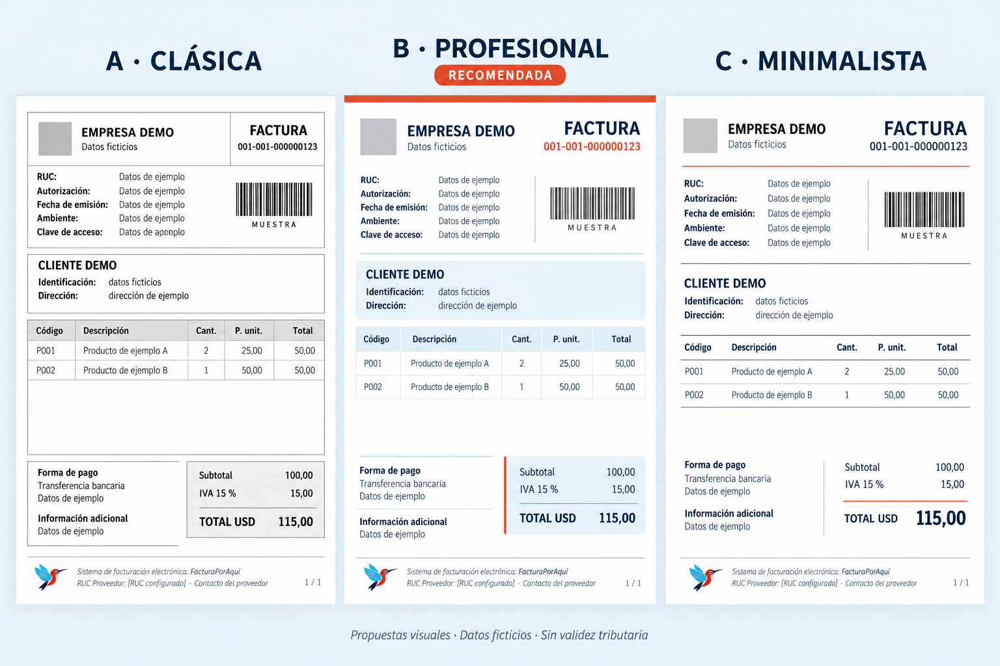

# Propuesta de diseño de documentos A4 — 24/10/2026

Estado: **propuesta para elección de la propietaria; no implementada**. Se solicita escoger antes de modificar las plantillas o encargar la implementación. Rama frontend/etapa3.

Referencia visual: factura actual adjunta de una página A4 y captura de Importadora Tomebamba aportadas por la propietaria. Los originales tienen datos reales y no se incorporan al repositorio. La comparativa usa exclusivamente datos ficticios.

La imagen generada es una maqueta conceptual, no una plantilla fiscal completa ni un comprobante emitido. Sus códigos de barras son ilustrativos y no validan lectura. Las etiquetas abreviadas, importes e IVA de ejemplo no sustituyen los campos ni cálculos del backend.

## Opciones

| Opción | Apariencia | Ventaja principal |
| --- | --- | --- |
| A — Clásica optimizada | Bordes finos, grises y distribución compacta. | Impresión económica y familiar para contabilidad. |
| B — Profesional con marca, recomendada | Jerarquía azul oscuro, celeste tenue y acentos coral pequeños. | Lectura clara con identidad de FacturaPorAquí y predominio del blanco. |
| C — Minimalista editorial | Separadores horizontales, menos recuadros y mayor espacio en blanco. | Documento sobrio; puede ocupar más páginas con mucho contenido. |

## Base común propuesta

- A4 vertical, contenido de 190 mm y márgenes laterales de 10 mm. Reservar espacio independiente para el pie. La guía ya usa `.hoja` de 190 mm y debe conservarlo.
- Logo de la empresa emisora proporcionado, sin estirar ni reemplazarlo con el de la plataforma. Colibrí Ingenioso pequeño junto a la identificación del proveedor en el pie.
- Cabecera de dos columnas: identidad/domicilios/datos tributarios del emisor y bloque de control del documento. Número, autorización, fechas, ambiente, emisión y clave íntegros cuando correspondan.
- Código de barras más compacto, conservando proporción, zona libre y clave legible; tamaño definitivo condicionado a prueba de lectura del PDF y de una impresión. No fijar un ancho que comprima las barras de forma arbitraria.
- Datos del receptor en un bloque claro. Tabla con más espacio para descripción, importes alineados a la derecha, cifras tabulares y descuentos visibles.
- Cuerpo orientativo de 9,5–10,5 pt y pie de 8–8,5 pt, con contraste suficiente. No encoger toda la factura para forzar una sola página.
- Tabla con encabezado repetido cuando continúe; evitar partir filas cortas y permitir textos largos sin recortes. Totales al final, sin superposición con el pie. Página n de N.
- Fondos muy tenues y bordes finos para conservar legibilidad en escala de grises. No copiar declaraciones jurídicas, firmas ni condiciones comerciales particulares de Tomebamba.

## Identificación del proveedor en el pie

Propuesta de texto en cursiva, separada del contenido por una línea fina:

*Sistema de facturación electrónica: [nombre configurado del proveedor] · RUC Proveedor: [RUC configurado]*  
*[correo configurado] · [dirección configurada]*

Usar los cuatro valores ya disponibles: proveedor.nombre, proveedor.ruc, proveedor.email y proveedor.direccion. Ajustar a más líneas si es necesario, sin truncar datos ni reducirlos a texto ilegible. La maqueta agrupa correo/dirección como «Contacto del proveedor» solo por ser una comparación conceptual.

La auditoría interna AUDITORIA-SRI-2026-10.md, consultada por Claude el 11/10/2026, cita la Res. NAC-DGERCGC26-00000027 y el Anexo 26 de la ficha técnica como fundamento del campo adicional «RUC Proveedor». No se comprobó nuevamente la fuente oficial: sri.gob.ec respondió con bloqueo de conexión 403 del proxy del entorno. No se afirma que pie de página o cursiva sean ubicaciones/estilos exigidos por el SRI. Antes de implementar su traslado visual, Claude debe contrastar la ubicación y texto con la fuente oficial. En todo caso, conservar el campo adicional del XML y los datos actuales: el rediseño no altera la lógica fiscal.

## Adaptación según documento

- Factura y liquidación de compra: detalles, descuentos, subtotales separados por tarifa, impuestos, total y formas de pago.
- Nota de crédito: documento modificado y su fecha, motivo e importes acreditados. Revisar la correspondencia de fechas del template antiguo señalada en la auditoría antes de reutilizarlo.
- Nota de débito: documento modificado, motivos, valores e impuestos correspondientes.
- Retención: sujeto retenido, sustento, período fiscal, impuesto, código, base, porcentaje y valor retenido. No titular el resumen «Total a pagar».
- Guía de remisión: transportista, placa, fechas, partida, destino, motivo/ruta, sustento y cantidades; sin precios ni totales monetarios.

## Alcance de esta entrega

Solo propuesta gráfica y documentación. Se revisaron las referencias y plantillas mediante lectura; no se ejecutó una emisión, no se modificaron templates, backend, XML ni numeraciones. La imagen no es una prueba de paginación, legibilidad impresa, lectura de código de barras ni cumplimiento fiscal. Esas comprobaciones se harán con PDFs ficticios de pocas y muchas líneas cuando se elija el estilo y se implemente.
