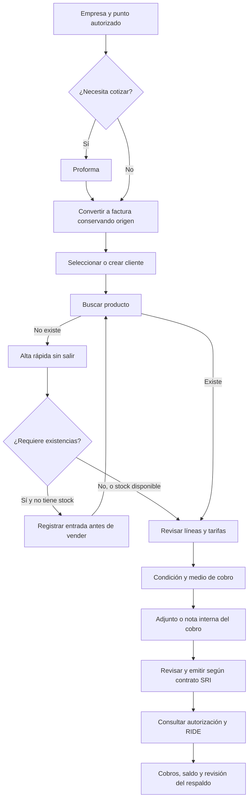

# ERPNext como referencia de procesos para FacturaPorAquí

Revisión del 30/10/2026. Fuente: repositorio indicado por la propietaria, [Jen456/erpnext](https://github.com/Jen456/erpnext/tree/352583128432733415df48c1509f86ef97cf7688), commit `352583128432733415df48c1509f86ef97cf7688`. Su `erpnext/__init__.py` declara **13.0.0-dev**: es la versión de ese fork, no se presenta como ERPNext actual. Se leyó su código; no se instaló ni se validó una instancia de Frappe. No se copió código, recursos ni estilos. La implementación aquí usa Django, AdminLTE y los contratos existentes.

## Qué sí se acopla

ERPNext organiza el trabajo alrededor de documentos enlazados, con acciones que dependen de su estado. Evita volver a escribir datos al convertir un documento y permite crear registros maestros desde el formulario que los necesita. Esos patrones encajan; adoptar su plataforma o toda su complejidad no es requisito.

| Proceso en el fork revisado | FacturaPorAquí: adaptación y límite |
| --- | --- |
| Cliente / Item creados con Quick Entry y devueltos al formulario de origen | Crear cliente/producto sin navegar fuera de la factura. Ya existía alta de cliente; esta entrega incorpora el alta contextual del producto. Los permisos siguen en el servidor. |
| Quotation → Sales Order y mapeo a Sales Invoice | Proforma → factura con el contrato existente. Un pedido comercial intermedio sería opcional y requiere backend; no introducirlo como paso obligatorio. |
| Sales Invoice desde pedido, cotización o entrega | Conservar referencias, cantidades y estado de conversión. La conversión de proforma ya existe en la rama integrada; no se afirma que esté publicada. |
| Delivery Note y cantidades pendientes | La guía 06 se puede iniciar desde la factura con cantidades pendientes. **Una Delivery Note no equivale automáticamente a la guía legal del SRI**, ni a un establecimiento o bodega. Mantener su contrato fiscal. |
| Payment Entry enlazado al documento y a la cuenta del tercero | Cobros y saldos deben enlazarse a la factura/CxC. Separar condición contado/crédito, medio efectivo/transferencia/etc., referencia y respaldo. Un archivo no acredita por sí solo el abono. |
| Return, Credit Note y estados del documento | Usar NC/ND y anulaciones permitidas por el backend ecuatoriano; no copiar el cambio genérico de `docstatus` como anulación en el SRI. |
| Purchase Order → Purchase Receipt → Purchase Invoice → Payment Entry | El alcance actual tiene Compras, importación, proveedores, retenciones y CxP. Pedido y recepción física separados son una futura decisión de producto, no un cambio visual de esta tarea. |
| Campos Link, tablas de líneas, grupos plegables | Cliente/categoría por selección, búsqueda de producto, sección de pago, resumen visible. Los datos opcionales del alta se pliegan. En móvil las líneas se convierten en tarjetas conservando los campos originales. |
| Company, Warehouse y permisos para documentos | Reutilizar empresa, establecimientos y puntos existentes. Un RUC, un local, un punto de emisión y una bodega son conceptos diferentes. La selección individual y numeración siguen pendientes del contrato de locales. |

## Recorrido propuesto para la operación diaria

El diagrama es una propuesta funcional: el respaldo del cobro y la selección individual de punto aún necesitan backend. No altera los requisitos legales para emitir ni hace obligatorio un pago previo para una venta a crédito.

## Problema concreto de contado / efectivo

`Sale.payment_type` usa `efectivo` / `credito`. El formulario y su validación exigen `cash` y calculan `change` cuando el valor es `efectivo`; `SaleCreateView` usa esos campos. `payment_method` es la forma de pago del comprobante SRI y no identifica inequívocamente la recepción bancaria. No basta esconder los inputs ni interpretar «Otros con utilización del sistema financiero» como transferencia.

El modelo de cobros `PaymentsCtaCollect` ya tiene `medio_pago`, `referencia`, `description`, `registrado_por` y `registrado_en`. Reutilizarlos cuando corresponda; faltan adjunto, revisión y una relación consistente para ventas al contado. No guardar notas de cobro en `additional_info`: esos datos pueden terminar en el XML/RIDE. No modificar saldos basándose solamente en la presencia de una imagen.

## Implementado en esta entrega

- Formulario real de factura en tres secciones: cliente/documento, productos/servicios y pago/resumen.
- Botón visible de alta de producto, con el formulario del servidor dentro de un diálogo. Coste, descripción e imagen en sección plegable.
- Guardado real usando el endpoint vigente; recuperación por código e incorporación automática si no requiere stock o tiene existencias. Inventariado sin stock se crea pero no se añade a la venta.
- Conservación de cliente, líneas, cantidad e información adicional mientras se abre/cierra el alta.
- Errores por campo, comprobación de duplicados, bloqueo de doble envío y consulta sin repetir un POST de alta cuando su respuesta se pierde.
- Maqueta del respaldo del cobro, aislada del formulario operativo.

## Qué sigue a cargo de Claude

1. Contrato para respaldo del cobro: ver README y HANDOFF. Adaptar correctamente contado/medio de pago sin romper saldos, referencias ni valores históricos.
2. Mejorar la respuesta de alta de producto para devolver su identidad/JSON directamente. Actualmente devuelve `{}` y hay que recuperarlo por código. Las restricciones de unicidad se mantienen; un conflicto concurrente puede devolver un mensaje SQL poco legible.
3. La comprobación orientativa de nombre usa `validate_data`, `pattern=pattern`, `name`, `category` (así lo implementa la vista actual). El formulario de Bodega envía `pattern=name`, que la vista no comprueba: documentado para corrección, sin cambiar backend aquí.
4. Persistencia de borradores de factura y protección frente a cambio de empresa en otra pestaña: necesitan un contrato de servidor. Esta entrega conserva el formulario abierto; no promete recuperación al cerrar el navegador.
5. Contrato de locales/puntos, ya documentado en la entrega anterior. No mezclarlo con bodegas o caja contable.

## Fuentes concretas revisadas

Rutas relativas al commit del fork indicado arriba:

- `erpnext/public/js/utils/item_quick_entry.js`: `render_dialog`, `register_primary_action`, `after_insert` y actualización del enlace llamante.
- `erpnext/public/js/utils.js`: `create_new_doc` invoca Quick Entry.
- `erpnext/stock/doctype/item/item.json`: `quick_entry`, campos y secciones plegables.
- `erpnext/accounts/doctype/sales_invoice/sales_invoice.json`: cliente, artículos, pagos y secciones secundarias.
- `erpnext/accounts/doctype/sales_invoice/sales_invoice.js`: acciones por estado; mapeo desde cotización/pedido/entrega; pago y devolución.
- `erpnext/selling/doctype/quotation/quotation.js`: creación de pedido desde cotización válida.
- `erpnext/accounts/doctype/payment_entry/payment_entry.js`: referencias a documentos y filtros por empresa/tercero.
- `erpnext/accounts/doctype/purchase_invoice/purchase_invoice.js`: orden/recepción, pago y devolución.

No se adopta el catálogo tributario, las reglas contables ni el motor de stock de ERPNext. La referencia orienta la interacción; el servidor de FacturaPorAquí conserva sus reglas del SRI.
